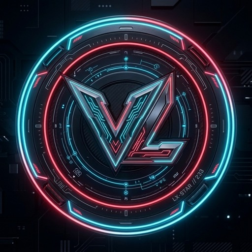

# 🌐 Link.bio — Văn Lương Personal Bio Page

<p align="center">
  
</p>

<p align="center">
  <b>Trang Bio Link cá nhân hiện đại với giao diện Bento Grid, phong cách Gaming / Cyberpunk, hiệu ứng 3D Tilt tương tác và âm thanh nền sống động.</b>
</p>

<p align="center">
  <a href="https://luong-bio.netlify.app/"></a>
  <a href="https://github.com/LXSTAR233/Link.bio"></a>
  
</p>

---

## 📖 Giới thiệu (Overview)

**Link.bio** là trang web liên kết cá nhân (Bio Link / Portfolio Landing Page) được xây dựng dành cho **Văn Lương** ([@LXSTAR233](https://github.com/LXSTAR233)). Dự án được thiết kế theo xu hướng **Bento Grid** hiện đại, kết hợp tông màu tối huyền bí và hiệu ứng ánh sáng neon lấy cảm hứng từ các tựa game nổi tiếng như Valorant.

Trang web đóng vai trò là cầu nối tổng hợp toàn bộ các kênh mạng xã hội, nhóm cộng đồng, dự án phần mềm và công cụ tiện ích của tác giả vào một nơi duy nhất.

---

## ✨ Tính năng nổi bật (Key Features)

- 🎬 **Cinematic Intro**:
  - Màn hình mở đầu phong cách điện ảnh với lời chào *"WELCOME TO LUONG BIO"*.
  - Tích hợp nút **SKIP** nhanh, hỗ trợ phím tắt (`Esc`, `Enter`, `Space`) hoặc chạm bất kỳ đâu để bỏ qua.
  - Sử dụng `sessionStorage` ghi nhớ phiên truy cập, tránh lặp lại gây phiền hà cho người dùng.
  - Tương thích tốt với chế độ giảm chuyển động (`prefers-reduced-motion`).

- 🍱 **Bố cục Bento Grid & Giao diện Cyberpunk**:
  - Sắp xếp thẻ thông tin khoa học, trực quan, cân đối trên mọi kích thước màn hình.
  - Hiệu ứng chữ glitch neon, viền chạy hoạt họa (`animated-border`), lớp ánh sáng lấp lánh (`shimmer-layer`).
  - Thẻ thông tin cá nhân kèm huy hiệu xác minh (verified badge).

- 🎴 **Hiệu ứng 3D Card Tilt mượt mà**:
  - Thẻ tự động nghiêng theo góc nhìn của con trỏ chuột (`perspective`, `rotateX`, `rotateY`).
  - Tối ưu hiệu năng bằng `IntersectionObserver`, chỉ kích hoạt animation khi thẻ xuất hiện trong khung nhìn.

- 🎵 **Trải nghiệm đa phương tiện (Multimedia Background)**:
  - Video nền sống động (`background.mp4` / `background.webm`) kèm lớp phủ bóng mờ điện ảnh và hiệu ứng hạt.
  - Nhạc nền thư giãn (`chill.mp3`) tự động phát hoặc kích hoạt thông minh sau tương tác chạm/click đầu tiên của người dùng.

- 💬 **Discord Modal Popup**:
  - Hộp thoại tương tác giới thiệu server Discord và hướng dẫn nhận tiện ích / công cụ.
  - Hỗ trợ đóng mở linh hoạt: phím `Esc`, bấm ra ngoài vùng đen hoặc bấm nút Cancel.
  - Đảm bảo khả năng tiếp cận (Accessibility - trap focus khi mở modal).

- 🚀 **Tối ưu tốc độ tải trang & SEO**:
  - Thuần **HTML5**, **CSS3** và **Vanilla JavaScript**, không phụ thuộc vào framework nặng.
  - Kỹ thuật tải bất đồng bộ (Non-blocking) cho Google Fonts và Font Awesome, chống giật layout và render trang tức thì.
  - Thẻ OpenGraph và Twitter Card hoàn chỉnh, hiển thị preview đẹp mắt khi chia sẻ liên kết.

---

## 🔗 Các liên kết tích hợp trong trang

| Kênh / Dự án | Mô tả |
| :--- | :--- |
| **TikTok** | [@van_luong27](https://www.tiktok.com/@van_luong27) — Kênh video Highlights & Funny moments |
| **Facebook** | Trang cá nhân kết nối trực tiếp với Văn Lương |
| **Zalo Group** | Cộng đồng giao lưu, chia sẻ kinh nghiệm |
| **Discord Server** | Server thảo luận và kênh chia sẻ `#val-tweaks` |
| **Lxstar Launcher** | [lxstarlauncher.netlify.app](https://lxstarlauncher.netlify.app/) — Launcher hỗ trợ Minecraft & công cụ tối ưu |
| **GitHub Bio Project** | Kho lưu trữ mã nguồn mở của dự án này |

---

## 📁 Cấu trúc thư mục (Project Structure)

```text
Link.bio/
├── .vscode/
│   └── settings.json       # Cấu hình môi trường soạn thảo VS Code
├── assets/
│   ├── Avatar.jpg          # Ảnh đại diện cá nhân
│   ├── background.mp4      # Video nền chất lượng cao
│   ├── background.webm     # Video nền định dạng WebM tối ưu dung lượng
│   ├── chill.mp3           # File âm thanh nền lofi / chill
│   └── icon1.png           # Biểu tượng Discord / icon trang trí
├── css/
│   └── style.css           # Toàn bộ CSS giao diện, Bento Grid, hiệu ứng neon & animation
├── js/
│   └── main.js             # Xử lý Intro cinematic, phát nhạc nền, hiệu ứng 3D tilt
├── icon2.png               # Icon minh họa dự án Bio
├── icon3.jpg               # Icon minh họa Zalo & Lxstar Launcher
├── icon4.jpg               # Icon minh họa Facebook
├── index.html              # File HTML chính chứa toàn bộ bố cục trang và Discord Modal
└── README.md               # Tài liệu hướng dẫn sử dụng và thông tin dự án
```

---

## 🚀 Hướng dẫn cài đặt & Chạy cục bộ (Local Setup)

Không cần cài đặt Node.js hay môi trường phức tạp:

1. **Clone repository về máy:**
   ```bash
   git clone https://github.com/LXSTAR233/Link.bio.git
   cd Link.bio
   ```

2. **Chạy trang web:**
   - **Cách 1**: Mở trực tiếp file `index.html` bằng bất kỳ trình duyệt nào (Chrome, Edge, Firefox, Brave,...).
   - **Cách 2**: Sử dụng tiện ích mở rộng **Live Server** trên Visual Studio Code để có tính năng tự động tải lại (hot-reload) khi chỉnh sửa.

---

## 🛠️ Hướng dẫn tùy biến (Customization)

- **Thay đổi thông tin cá nhân**:
  - Chỉnh sửa tên, chức danh và thông điệp trong khối `.card--profile` tại file `index.html`.
  - Thay đổi ảnh đại diện bằng cách ghi đè file `assets/Avatar.jpg`.
- **Cập nhật liên kết mạng xã hội**:
  - Tìm các thẻ `<a href="..." class="card ...">` trong `index.html` và thay đổi đường dẫn URL đích.
- **Thay đổi video hoặc nhạc nền**:
  - Đặt video mới vào thư mục `assets/` và cập nhật đường dẫn ở thẻ `<video id="bg-video-player">`.
  - Đặt nhạc mới vào `assets/chill.mp3` để thay đổi giai điệu nền.

---

## 🌐 Triển khai trực tuyến (Deployment)

Dự án là trang tĩnh (Static Site), do đó có thể dễ dàng triển khai miễn phí 100% trên các nền tảng:
- **Netlify**: Kéo thả thư mục dự án vào Netlify Drop hoặc kết nối với kho GitHub.
- **Vercel**: Nhập repository từ GitHub và nhấn Deploy.
- **GitHub Pages**: Bật GitHub Pages trong phần **Settings > Pages** của kho chứa mã nguồn.

---

## 👤 Tác giả (Author)

- **Văn Lương (LXSTAR233)**
- **GitHub**: [@LXSTAR233](https://github.com/LXSTAR233)
- **Live Website**: [luong-bio.netlify.app](https://luong-bio.netlify.app/)

---

<p align="center">
  Made with ❤️ by Văn Lương • <i>HS Lớp 9D1 Trường THCS Bản Lầm</i>
</p>
